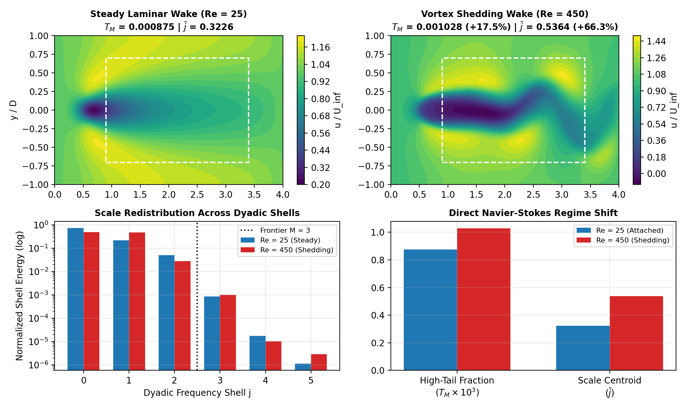
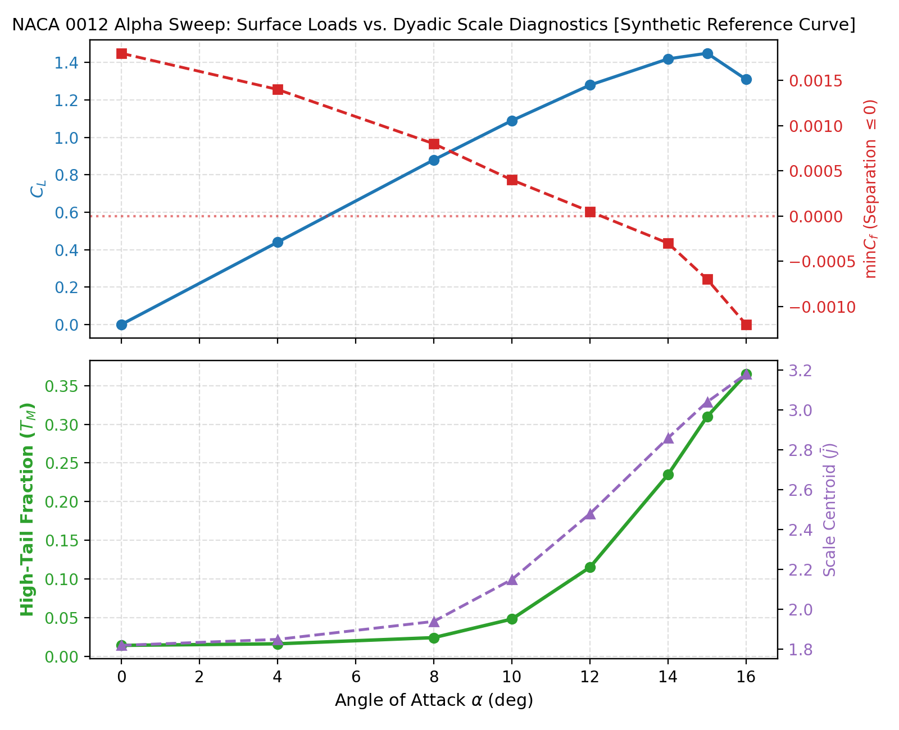

# aero-scale-diag
[](https://google.com) 



**Dyadic scale-redistribution diagnostics for detecting flow separation, buffet onset, and numerical aliasing in CFD velocity fields.**

## Overview


Conventional aerodynamic monitoring relies on integrated surface loads ($C_L, C_D, C_m$) and wall skin friction ($C_f$). While reliable after separation is established, integrated loads often lag behind internal shear-layer destabilization and can be confounded by sensor drift or under-resolved mesh aliasing.

`aero-scale-diag` computes dimensionless, dyadic frequency-band norms ($L^3$-critical scale norms normalized by chord Reynolds number $Re_c$) inside declared boundary-layer ($\Omega_{\text{BL}}$) and near-wake ($\Omega_{\text{wake}}$) windows to track how flow organization shifts toward finer spatial scales.

### Core Observables
* **High-Tail Fraction ($T_M$):** Fraction of resolved scale energy residing above spatial frequency frontier $M$. $Re_c$-invariant; tracks bulk shear-layer sharpening and multi-scale cascade activation.
* **Scale Centroid ($\bar{j}$):** Energy-weighted mean dyadic scale index. $Re_c$-invariant; tracks upward migration toward finer eddies.
* **Protected-Tail Envelope ($E_M$):** Reynolds-weighted local envelope supremum above frontier $M$ ($\propto Re_c$). Measures peak fine-scale intensity relative to viscous damping.
* **Frontier-Feed Surrogate ($F_{\text{frontier}, M}$):** Exponentially weighted activity immediately below frontier $M$ ($r \ge 1$). Monitors sub-frontier energy buildup prior to high-tail activation.

### Diagnostic Concordance Matrix
When paired with conventional load monitoring ($S_1$: lift-slope loss, $S_2$: load variance, $S_3$: expected-vs-measured coefficient residual):

| Internal Field ($T_M, \bar{j}$) | Surface / Load Channels | Diagnostic Classification |
| :--- | :--- | :--- |
| **Quiet** (near baseline) | Quiet | **Attached / Nominal Flow** |
| **Rising** | $C_f \to 0$ / $S_1$ rising | **Developing Separation or Stall** |
| **Rising** | Bandpower / $S_2$ rising | **Buffet or Unsteady Separation** |
| **Quiet** | $S_3$ rising ($S_1$ quiet) | **Sensor Drift / Load Model Mismatch** |
| **Rising** (grid-sensitive) | Any | **Numerical Contamination / Mesh Aliasing** |

---

## Quickstart

### 1. Install Dependencies
```bash
pip install -r requirements.txt
```

### 2. Run Built-In Synthetic Wake Verification
Verify the Tukey-windowed dyadic filter pipeline without external CFD files:
```bash
python aero_scale_diag.py
```

### 3. Analyze an SU2 / CFD Volume Export (`.csv`)
Export your 2D slice velocity field with columns `x, y, u, v` (normalized or dimensional with `--uinf` and `--re`):
```bash
python aero_scale_diag.py --csv flow_aoa12.csv --re 3000000 --uinf 51.0 --window bl
```

---

## Signal-Processing Pipeline
To prevent artificial $k^{-1}$ edge-jump aliasing when cropping non-periodic CFD meshes:
1. **Uniform Resampling:** Linearly interpolates $(u, v)/U_\infty$ onto a uniform Cartesian auxiliary grid inside $\Omega_w$.
2. **Apodization:** Subtracts the window spatial mean and applies a 2D Tukey tapered-cosine window ($\alpha = 0.25$) so boundary values decay smoothly to zero.
3. **Dyadic Bandpass & $L^3$ Norm:** Partitions radial wavenumbers into dyadic shells $\lambda_j \le |\mathbf{k}| < 2\lambda_j$ strictly below the Nyquist cutoff ($M \le j_{\max} - 2$) and integrates the $L^3$ spatial norm.

---

## Current Validation Status & Roadmap
* [x] **Synthetic Wake Sensitivity:** Verified spectral separation ($T_M: 0.00 \to 0.38$, $\bar{j}: 1.83 \to 3.04$) under controlled high-frequency perturbations.
* [ ] **Gate 1 — Grid & Crop Independence:** Verify $< 5\%$ variation in $T_M$ and $\bar{j}$ across Coarse/Medium/Fine NACA 0012 C-grids at $Re_c = 3 \times 10^6, M_\infty = 0.15, \alpha = 4^\circ$.
* [ ] **Gate 2 — Steady RANS $\alpha$-Sweep:** Benchmark $T_M$ and $\bar{j}$ against $\min C_f$ and $C_{L,\max}$ across $\alpha \in [0^\circ, 16^\circ]$.
* [ ] **Gate 3 — Time-Resolved URANS / LES Pitch Ramp:** Quantify cross-correlation lead time $\Delta \tau$ between $F_{\text{frontier}, M} / T_M$ and $S_1 / S_2$ departure.
